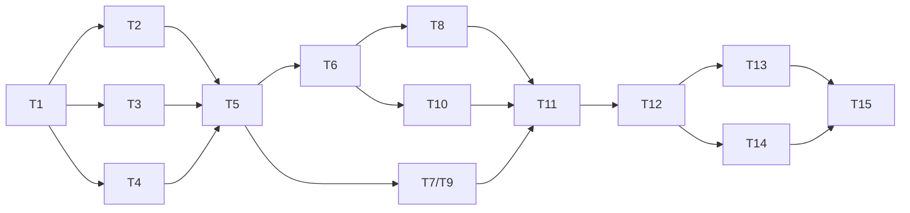

# Engineering summary

> AI assists the engineer within tasks; the engineer owns execution and quality.

## 1. Plan

Done means: `./gradlew build` green, a test that would fail without the change, an AI-log entry, docs updated.
High-impact tasks also need a human sign-off ([SIGNOFF](SIGNOFF.md)).

| Task | Intent | Depends on | Acceptance criteria | State |
|---|---|---|---|---|
| T1 | Reproducible build with gates | none | `build` runs format, tests, SpotBugs, coverage; Compose starts Postgres | Done |
| T2 | Schema + JDBC repository | T1 | Same URL twice → two links; taken code → empty; deleted code never reused; 32-way race → 1 winner | Done |
| T3 | URL validation + host guard | T1 | `%20` and query preserved; internal hosts rejected; normalisation idempotent | Done |
| T4 | Code generator | T1 | Exact vectors; bijection; uniformity; forced collision → retry → `503` | Done |
| T5 | Create/get/delete, idempotency, API key | T2, T3, T4 | `201/200/401/403/404/409/410` matrix; per-caller idempotency | Done |
| T6 | Fast redirect | T5 | Cache hit/miss/negative; `302/404/410`; single-flight | Done |
| T7/T9 | Analytics, then off the critical path | T5 | Clicks counted; redirect survives analytics failure; drops counted; flag rolls back | Done (k6 script ready, not run) |
| T8 | Abuse protection + contract | T6 | `429` + `Retry-After`; spoofed XFF ignored; uniform errors; OpenAPI | Done |
| T10 | Ambiguous: expiry, private links | T6 | Decision with rejected alternatives; boundary tests | Done (private deferred) |
| T11 | Review-driven refactor | T7/T9, T8, T10 | Aliases removed; Bucket4j; hashed mandatory keys; error model; docs consolidated | Done |
| T12 | Security hardening | T11 | No committed key; scopes; expiry; auth-failure throttle; replay → `410`; HEAD not counted; actuator on 8081; IPv6 /64 | Done |
| T13 | Reviewer experience | T12 | Docker-only quick start; per-run key in `local`; `local` by default from a checkout; smoke test; docs condensed | Done; build to re-run |
| T14 | Close link creation | T12 | `POST` without key `401`, without scope `403`; `created_by` stored; same Idempotency-Key from two clients → two links; create limit follows the key across IPs | Done; build to re-run |
| T15 | Delivery orchestration | T13, T14 | Graph validated (cycles, joins); gates run real commands; unsigned S1–S5 keep the release gate shut; retries bounded; a fallback pass is never cached as clean; ledger tamper-evident; a changed input re-plans only its descendants | Done (65 control-plane tests); first real run: engineer |

**Sequencing.** T2, T3 and T4 can proceed in parallel after T1; T5 is the join that needs all three; T6 and T7/T9 then
run in parallel; T11 joins T7/T9, T8 and T10. The pipeline's stages are the delivery view of these tasks
([ARCHITECTURE §8](ARCHITECTURE.md#8-delivery-orchestration)).

## 2. Artifacts

Code by feature in `src/main/java`; Flyway `V1`–`V4`; contract at `/v3/api-docs`; `Dockerfile` (multi-stage, non-root,
AOT cache), `docker-compose.yml`; CI `ci.yml` + `security.yml`; `scripts/` (key generator, smoke test); k6 in `load/`;
delivery control plane in `orchestration/` (stage graph, runner, ledger, metrics, 65 tests);
traceability: [AI-LOG](AI-LOG.md), [SIGNOFF](SIGNOFF.md), PR template.

## 3. Testing approach and validation

**Pyramid:** pure unit tests → service tests with mocks → integration tests on **real PostgreSQL 17** via Testcontainers
(`JdbcLinkRepositoryIT`, `LinkApiIT`, `ApiKeySecurityIT`, `RateLimitIT`, `RedirectResilienceIT`, `ErrorHandlingIT`) →
smoke test of a running instance → k6. No H2: the guarantees under test are PostgreSQL behaviour.

| Gate | Where |
|---|---|
| Format | Spotless (Palantir) in `build`; `spotlessApply` fixes |
| Static analysis | `-Xlint:all`; SpotBugs (suppressions justified in `config/spotbugs/exclude.xml`) |
| Tests + coverage | JUnit 5 + Testcontainers; JaCoCo ≥ 80% instructions |
| End to end | `scripts/smoke-test.sh <key>`: 17 checks, non-zero exit on failure |
| Security | CodeQL, dependency review on PRs, Dependabot alerts |
| Performance | k6 at a fixed request rate ([load/README.md](../load/README.md)); script ready, **not run yet** |
| Delivery pipeline | `python3 orchestration/run.py plan` / `run`: gates, approvals, ledger; control-plane tests and ledger check in CI |
| Human review | Sign-offs S1–S5 for schema, URL guard, security, rate limits and the pipeline policy |

**What has actually run** (engineer's machine): T11 green with 124 tests; T12 137 tests; T14 148 tests, 0 failures,
coverage 95.1% instructions / 80.8% branches. After the SpotBugs fixes (AI-LOG 14) and the rename (AI-LOG 16),
`./gradlew spotlessApply build` passed in full (tests, SpotBugs, JaCoCo, Spotless), and `scripts/smoke-test.sh` passed
against the running Docker Compose app. k6: not run (script ready); no performance numbers are claimed.
**Control plane (AI sandbox):** 65 unit tests pass (Python 3.13); the full lifecycle of the real stage graph was
rehearsed with stubbed build tools (blocked on sign-off → signed → cached → re-planned after one edit). That rehearsal
proves the scheduling, approval and re-plan logic, **not** that the real build passes. No real pipeline run exists yet,
so there are no measured reliability metrics: the ledger and `METRICS.md` come from the engineer's first run.

## 4. Risks and guardrails

| Risk | Guardrail | Evidence |
|---|---|---|
| Two creates race for one code | `UNIQUE(code)` + `ON CONFLICT DO NOTHING` | 32-way race IT; 40-way psql run |
| Code collision | Bounded redraw + metric | `LinkServiceTest` |
| Deleted code reissued (hijack) | Soft delete + `UNIQUE(code)` | `JdbcLinkRepositoryIT` |
| Redirects to internal hosts | Scheme allowlist, host guard, length cap | `UrlValidatorTest`; S2 |
| Analytics overload hurts redirects | Bounded queue, drop-and-count | `RedirectResilienceIT`, `AsyncClickRecorderTest` |
| Hot rows, cache stampede | Aggregated sorted upserts; Caffeine single-flight | `ClickAggregatorTest`, `LinkCacheTest` (64 threads → 1 load) |
| Spam/phishing via the shortener | Create needs a `links:create` key; per-key limit; `created_by` to find and remove a client's links | `LinkApiIT`, `RateLimitIT`; S3 |
| Abuse, key guessing | Per-IP redirect buckets (IPv6 by /64), failure throttle; spoofed XFF ignored | `RateLimitIT`, `RateLimiterTest` |
| Management vandalism | Hashed, scoped, expiring keys; none committed; create/delete audit | `ApiKeySecurityIT`, `ShortenerPropertiesTest` |
| Production started without keys | Fail-fast outside `local`; an explicit profile wins over the checkout default | `ApiKeyRegistryTest`; S3 |
| Inflated click counts | HEAD not counted | `LinkApiIT.stats_*` |
| Leaked internals | Generic `500` + `traceId`; actuator on its own port | `ErrorHandlingIT`; config |
| AI work shipped without human approval | Release gate needs S1–S5; the engine reads sign-offs and never writes them | `ApprovalTests`; S5 |
| A fallback mistaken for a pass | `DEGRADED` is flagged, counted, and never served from cache | `ResilienceTests` (found in review, AI-LOG 15) |
| Audit trail edited after the fact | Hash-chained ledger; `run.py verify` in CI | `LedgerTests` |
| Applied migration edited | V1–V3 pinned by SHA-256; a mismatch aborts the run | `GateTests`, preflight |
| DB outage | Cached redirects continue; others fail fast with `503` | Design only (no automated outage test) |

## 5. Assumptions

As in [ARCHITECTURE §1](ARCHITECTURE.md#1-problem-and-assumptions), plus: single region; API keys are for operators;
analytics days are UTC; the service never fetches targets.

## 6. Limitations

- Per-instance cache and rate limits (D2 has the Redis path).
- Keys identify integrations, not end users: no per-user ownership or private links.
- No malware/phishing reputation check; hostnames resolving to private IPs are not blocked.
- Analytics approximate under overload; up to 1 s of clicks lost on a crash.
- No load-test results: the k6 script exists but has not been run, so latency under load is unmeasured.
- Sync and async analytics shipped in one change behind a flag, not as baseline + refactor commits.
- No architecture-rule tests (ArchUnit); package boundaries rely on review and event-based decoupling.
- The control plane governs the AI's work but does not launch it; fingerprints are taken when a run starts (no mid-run
  re-plan); a sign-off is a name in a Markdown table, so identity rests on git history and review; one machine.

## 7. Ownership

Every AI output is untrusted until reviewed and tested. The engineer approves each change (PR template), signs the
high-impact records, and owns correctness, maintainability and production readiness.
