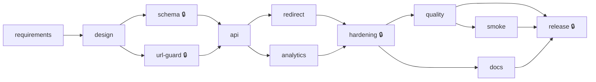

# Orchestration control plane

The delivery pipeline of this project, as code: a **stage graph** with dependencies, entry and exit gates, human
approvals, bounded retries, a declared fallback, opt-in rollback and a tamper-evident audit ledger.

> **What it is, and what it is not.** The engine does not write code and does not call an AI. It *governs* the work an
> AI agent does: it decides what may start, runs the gates that prove a stage is done, refuses to pass a stage that
> needs a human until the human has signed, and records every decision. The agent work inside a stage is done by
> Claude under that stage's rules, and each stage names the [AI-LOG](../docs/AI-LOG.md) entries that cover it.
> Standard library only; Python 3.9 or newer.

```bash
python3 orchestration/run.py plan      # what would run, in which parallel waves, and why (writes nothing)
python3 orchestration/run.py run       # run it: gates, approvals, retries, ledger
python3 orchestration/run.py report    # reliability metrics from the ledger -> orchestration/METRICS.md
python3 orchestration/run.py verify    # check the ledger's hash chain
python3 orchestration/run.py graph     # the stage graph as a Mermaid diagram
```

---

## The stage graph

Defined in [`pipeline.json`](pipeline.json); the normalised requirements that feed it are in
[`requirements.md`](requirements.md). `🔒` marks stages that need a human sign-off.



- **Parallel paths:** `schema ‖ url-guard`, `redirect ‖ analytics`, `quality ‖ docs`.
- **Synchronisation points (joins):** `api` waits for both `schema` and `url-guard`; `hardening` for both `redirect` and
  `analytics`; `release` for `quality`, `smoke` and `docs`.
- **Shared resource:** gates marked `"exclusive": "gradle"` never run at the same time, because two Gradle builds in
  one folder block each other. Parallel stages still overlap on everything else.

| Stage | Agent produces | Exit gate (proof it is done) | Human |
|---|---|---|---|
| `requirements` | Normalised requirements R1–R10 | Requirements table and assumptions section exist | |
| `design` | Architecture and decisions D1–D9 | Nine decisions and the failure-modes section exist | |
| `schema` | Flyway migrations, JDBC repository | `JdbcLinkRepositoryIT` on real PostgreSQL | S1 |
| `url-guard` | URL validation, host guard, code generator | Validator, Base58 and generator unit tests | S2 |
| `api` | Create, get, delete, idempotency | Service tests and the HTTP matrix on PostgreSQL | |
| `redirect` | Cached redirects | Cache single-flight, redirect resilience | |
| `analytics` | Click analytics off the request path | Recorder, aggregator, event tests; **fallback:** release in `sync` mode (D4) | |
| `hardening` | API keys, scopes, rate limits, error model | Security, rate-limit and error-model tests | S3, S4 |
| `quality` | Nothing new: verifies everything | `./gradlew build`: Spotless, `-Xlint`, tests, SpotBugs, JaCoCo ≥ 80% | |
| `smoke` | Nothing new | `scripts/smoke-test.sh` against the running service | |
| `docs` | Documentation | Every relative link and `#anchor` resolves; AI log complete | |
| `release` | Nothing new | **Release gate:** every sign-off upstream (S1–S4) is granted | S5, and all upstream |

---

## How a run works

1. **Preflight (policy).** Before any stage: the applied migrations `V1`–`V3` must be byte-identical to their recorded
   SHA-256 (editing one would break Flyway's checksum on the engineer's database), and no committed secret or default
   key may appear in the code. A violation **aborts the run** (exit 3) before anything starts.
2. **Plan.** Each stage gets a fingerprint (see [Re-planning](#re-planning)). Unchanged stages are reused; the rest are
   scheduled in dependency order, up to `max_workers` in parallel.
3. **Entry gates.** Preconditions such as Docker or an API key. A miss is `BLOCKED`, not a failure: nothing was attempted.
4. **Exit gates.** The proof. A command gate marked `transient` (Testcontainers startup, image pulls) is retried at
   most `retries` times, never more than `policy.max_retries` (2), with a growing back-off. Anything else runs once.
5. **Fallback.** If a stage has a declared fallback and its primary gates fail, the fallback's own gates run. If they
   pass the stage is `DEGRADED`: downstream work continues, the ledger and metrics record it, and it is **never**
   cached as a clean pass: the primary gates are tried again next run.
6. **Failure → safe-stop.** The first `FAILED` stage stops new stages from starting (running ones finish). Dependent
   stages are `SKIPPED`. `--keep-going` lets independent branches continue instead.
7. **Rollback.** On failure the ledger records the stage's rollback command. It is only **executed** with `--rollback`
   (default: recommend, don't act): it restores that stage's code from the git tag `pipeline/last-green`, which
   `--tag-green` moves after a fully green run. Migrations are forward-only; their "rollback" is a corrective migration.
8. **Approvals.** After a stage's gates pass, the engine reads [`docs/SIGNOFF.md`](../docs/SIGNOFF.md). Not signed →
   `AWAITING_APPROVAL`: the work continues, but the release gate stays closed. Rejected → `FAILED`. **The engine never
   writes a sign-off**; only a human edits that table.
9. **Operator stop.** Create the file `orchestration/STOP` and no further stage starts (kill switch).

Statuses: `PASSED`, `CACHED` (inputs unchanged), `DEGRADED` (fallback), `AWAITING_APPROVAL`, `FAILED`, `BLOCKED`,
`SKIPPED`.

### Autonomy boundaries

| The agent may | A human must |
|---|---|
| Change the files a stage owns and run that stage's gates | Sign S1–S5 in `SIGNOFF.md` (schema, URL guard, API keys, rate limits, this pipeline's policy) |
| Retry a transient gate, at most twice | Run with `--rollback`, `--tag-green` and `--keep-going` (never implied) |
| Ship through a declared fallback, flagged `DEGRADED` | Change `pipeline.json` or the frozen migration hashes (reviewed like code) |

The agent never edits an applied migration, commits secrets, or signs its own work.

### Exit codes (`run`)

`0` success · `1` a stage failed · `2` blocked or awaiting a human · `3` aborted (policy violation, invalid pipeline or
operator stop).

---

## Re-planning

Each stage has a **fingerprint**: the SHA-256 of its own definition, the contents of its input files, and the
fingerprints of every stage it depends on. At the start of a run the engine compares each fingerprint with the last time
that stage passed its gates, and writes one `replan` record to the ledger listing:

- **stale** stages, each with the reason: `changed_inputs` (which files), `upstream_changed` (which dependency) or
  `definition_changed` (the stage's entry in `pipeline.json`);
- **reused** stages, whose gates are not run again;
- **new** stages, never passed before.

Because fingerprints chain through the graph, a change propagates exactly as far as it should:

| You change | Re-run | Reused |
|---|---|---|
| A requirement in [`requirements.md`](requirements.md) | every stage (it is the root) | none |
| `LinkCacheTest.java` | `redirect`, `hardening`, `quality`, `docs`, `smoke`, `release` | `requirements`, `design`, `schema`, `url-guard`, `api`, `analytics` |
| Nothing | none | all |

`python3 orchestration/run.py plan` shows this before you run anything. Sign-offs are re-read on **every** run, never
cached: signing unblocks the release gate, and revoking a sign-off closes it again, without re-running any gate.

---

## The ledger

Every run appends to its own file, `orchestration/ledger/<run-id>.jsonl`. Each record carries the hash of the previous
one, so editing or deleting a record breaks the chain: `run.py verify` reports where (CI runs it on every push).

| Event | Records |
|---|---|
| `run_started`, `run_finished` | Options, outcome, duration |
| `preflight`, `replan` | Policy checks; which stages are stale, reused or new, and why |
| `stage_started`, `stage_finished` | Fingerprint, status, duration, and the **lineage**: upstream fingerprints, input file hashes, decisions (D-numbers), AI-log entries, approvals |
| `gate_result`, `gate_retry` | Each gate, its attempts and its output |
| `fallback`, `rollback_recommended`, `rollback_executed`, `safe_stop` | Every deviation from the happy path |

The ledger is also the engine's memory: what passed last time is read from it, so deleting it forces a full re-run.

## Reliability metrics

`run.py report` computes, from the ledger only, and writes `orchestration/METRICS.md` (created after the first real run):
stage success rate, first-attempt rate, retry frequency, rollbacks executed and recommended, fallbacks used, re-plans,
**MTTR** (from a stage's first failing execution to its next passing one), end-to-end latency (mean, median, max) and
parallel gain (sum of stage durations ÷ wall time; above 1.0 means stages overlapped). Blocked and awaiting-approval
stages are not counted as failures.

---

## Running it for real

Needs JDK 25, Docker and Python 3.9+. A first run on a clean checkout is expected to stop at the human checkpoints:

1. `python3 orchestration/run.py run`: once their gates pass, `schema`, `url-guard` and `hardening` finish as
   `AWAITING_APPROVAL`; `smoke` is `BLOCKED` (no running service or key), so `release` is `SKIPPED`.
2. Start the service and export its key: `docker compose --profile app up --build -d`, then
   `export SMOKE_API_KEY=<key from the log>`.
3. Review and sign S1–S5: fill the table at the bottom of `docs/SIGNOFF.md`, for example
   `| S1 | Your Name | 2026-11-04 | Approved | |`.
4. `python3 orchestration/run.py run --tag-green`: unchanged stages are `CACHED`, `smoke` runs, `release` passes.
5. `python3 orchestration/run.py report`, then commit `orchestration/ledger/`, `orchestration/METRICS.md`.

Tests for the control plane itself (no Docker, a few seconds):

```bash
python3 -m unittest discover -s orchestration -v
```

## Limitations

- The engine governs; it does not drive the AI. Agent steps are performed in the coding session and recorded through
  the AI log and the gates' evidence, not launched by the engine.
- Fingerprints are taken when a run starts. Files changed by a gate during the run are picked up by the next run, not
  re-planned mid-run.
- Sign-off is a table in a Markdown file: the engine checks it is filled in, not who filled it in. Git history and pull
  request review are the identity control; `pipeline.json` itself is protected only by that review.
- One machine, one process. Parallel Gradle builds are serialised by design.
- Rollback depends on the `pipeline/last-green` git tag existing, and discards uncommitted changes in the stage's paths.
